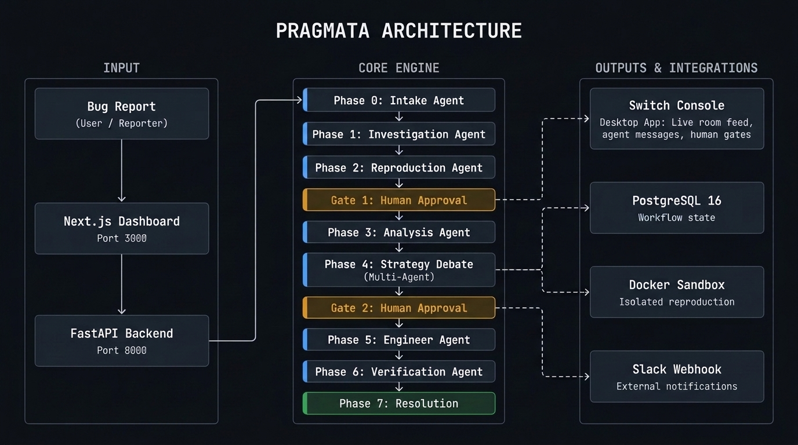

# PRAGMATA

**AI-powered bug investigation and resolution platform with deterministic human authority gates.**

An unstructured bug report goes in. A verified, developer-approved code fix comes out. Every agent finding, reproduction result, human decision, and verification outcome surfaces live in Switch Console.

---

## Architecture



```
Bug Report
    │
    ▼
Next.js Dashboard  ──────────────────────────────────────────────────────┐
    │                                                                      │
    ▼                                                                      │
FastAPI Backend                                                            │
    │                                                                      │
    ├── PostgreSQL 16         (workflow state & audit trail)               │
    ├── Docker Sandbox        (isolated bug reproduction)                  │
    ├── Switch Gateway        (protocol v0.31.0 — real-time room feed)  ◄─┘
    └── Slack Webhook         (external notifications)

9-Phase Workflow Engine
─────────────────────────────────────────────────────
  Phase 0   Intake            Parse & structure bug report
  Phase 1   Investigation     Static codebase analysis, fault localization
  Phase 2   Reproduction      Execute scenario in isolated Docker sandbox
  ● Gate 1  Human Approval    Developer accepts or rejects the bug
  Phase 3   Analysis          Root cause trace with code citations
  Phase 4   Strategy Debate   Multi-agent debate on 3 competing fixes
  ● Gate 2  Human Approval    Developer selects fix approach
  Phase 5   Implementation    Engineer agent writes the patch
  Phase 6   Verification      Regression tests run against patched code
  Phase 7   Resolution        Issue marked resolved, full audit trail saved
─────────────────────────────────────────────────────
  Gates are enforced. No code is written before Gate 2 approval.
```

---

## Stack

| Layer | Technology |
|---|---|
| Backend | FastAPI (Python 3.11+) |
| Frontend | Next.js 14 (TypeScript) |
| Database | PostgreSQL 16 |
| LLM Inference | Groq |
| Sandbox | Docker |
| Collaboration | Switch Console (gateway protocol v0.31.0) |
| Notifications | Slack Incoming Webhooks |

---

## Quickstart

### Prerequisites

- Python >= 3.11
- Node.js >= 18
- Docker and Docker Compose

### 1. Configure environment

```bash
cp .env.example .env
# Edit .env with your credentials
```

### 2. Start the database

```bash
docker compose up -d db
docker compose ps   # confirm healthy
```

### 3. Backend

```bash
cd backend
python -m venv .venv
.venv\Scripts\activate        # Windows
# source .venv/bin/activate   # macOS/Linux

pip install -r requirements.txt
alembic upgrade head
uvicorn app.main:app --host 0.0.0.0 --port 8000 --reload
```

Health check: http://localhost:8000/health  
API docs (DEBUG=true): http://localhost:8000/docs

### 4. Frontend

```bash
cd frontend
npm install
npm run dev
```

Dashboard: http://localhost:3000

---

## Demo Mode (Hackathon)

`branch-2` contains a self-contained hardcoded demo flow requiring no database or Docker.

```bash
git checkout branch-2
```

Start both servers as above, then open http://localhost:3000/demo.

The demo runs the full 9-phase workflow against a sample Node.js cart service (`demo/sample-node-cart`) with a real boundary-condition bug in `cart.js:30`. The Switch Console desktop app can be pointed at `http://localhost:8000` to see live agent messages stream into the workspace room.

See [`demo/DEMO_GUIDE.md`](demo/DEMO_GUIDE.md) for the full recording script and narration guide.

---

## Design Principles

1. **Human authority is non-negotiable.** AI agents investigate and propose. Consequential decisions — accepting a bug, selecting a fix, merging a patch — require explicit developer approval. The pipeline halts until it receives one.

2. **Evidence before certainty.** A bug is not confirmed plausible; it is confirmed reproducible. The Reproduction agent runs the scenario in an isolated sandbox and records output. That output is what the developer reviews at Gate 1, not a summary.

3. **No code changes before approval.** The workflow cannot reach Phase 5 (Implementation) without passing Gate 2. This is enforced by the state machine, not by convention.

4. **Verification before resolution.** An issue is marked resolved only after the patched code passes automated regression tests. The agent does not self-certify.

5. **Switch is the collaboration layer, not a notification sidecar.** Every agent message in a Switch room is a structured artifact — stack traces, code citations, test output, structured debate. Developers make Gate decisions with full context available in the tool they already use.

---

## Repository Structure

```
pragmata/
├── backend/
│   ├── app/
│   │   ├── api/
│   │   │   ├── demo.py        # Hardcoded demo flow (branch-2)
│   │   │   ├── gateway.py     # Switch Console gateway protocol server
│   │   │   └── ...
│   │   └── main.py
│   ├── tests/
│   └── requirements.txt
├── frontend/
│   ├── app/
│   │   ├── page.tsx           # Main dashboard
│   │   └── demo/page.tsx      # Demo control panel
│   └── package.json
├── demo/
│   ├── sample-node-cart/      # Target repo with intentional bug
│   └── DEMO_GUIDE.md
├── docker-compose.yml
└── .env.example
```

---

## Built for Flip the Switch Hackathon

[github.com/A23droid/pragmata](https://github.com/A23droid/pragmata)
